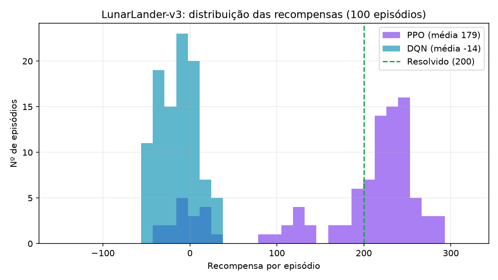

# Lunar Lander — Aprendizado por Reforço (PPO vs DQN)

Agentes de **aprendizado por reforço** que aprendem a pousar uma nave no ambiente **LunarLander-v3** (Gymnasium), usando **Stable-Baselines3**. O projeto compara dois algoritmos, **PPO** e **DQN**, treinados com 1 milhão de passos cada.

> Projeto acadêmico desenvolvido no MBA em Data Science & Inteligência Artificial (FIAP).

<p align="center">
  
  
</p>
<p align="center"><em>Agente PPO treinado pousando entre as bandeiras.</em></p>

## O problema
A nave precisa pousar suavemente na plataforma, entre as duas bandeiras, controlando os motores.

- **Observação (8 valores):** posição (x, y), velocidade (x, y), ângulo, velocidade angular e o contato de cada perna com o solo.
- **Ações (4, discretas):** não fazer nada, motor esquerdo, motor principal, motor direito.
- **Recompensa:** positiva por se aproximar da plataforma e por pousar, negativa por gastar combustível ou colidir. Um episódio com **200 pontos ou mais** é considerado resolvido.

## Abordagem
| | PPO | DQN |
|---|---|---|
| Biblioteca | Stable-Baselines3 2.7.0 | Stable-Baselines3 2.7.0 |
| Política | MLP | MLP |
| Passos de treino | 1.000.000 | 1.000.000 |
| Hiperparâmetros | padrão da biblioteca | padrão da biblioteca |

O objetivo foi comparar os dois algoritmos **nas configurações padrão**, sem ajuste de hiperparâmetros.

## Resultados
Avaliação de 100 episódios por modelo, com política determinística e seeds 0 a 99 (`python -m src.evaluate`).

| Métrica | PPO | DQN |
|---|---|---|
| Recompensa média | **179,1** (± 92,1) | -14,2 (± 21,8) |
| Mediana | **216,0** | -12,1 |
| Episódios com 200 pontos ou mais | **62%** | 0% |
| Episódios com 100 pontos ou mais | **81%** | 0% |
| Episódios com recompensa negativa | 9% | 72% |

<p align="center"></p>

### Análise
- O **PPO** aprendeu a pousar de forma consistente: a maioria dos episódios passa dos 200 pontos. A média (179) ficou abaixo do limiar de 200 por causa de uma minoria de episódios ruins, o que mostra espaço para melhoria.
- O **DQN**, com hiperparâmetros padrão e 1 milhão de passos, **não convergiu**. Uma hipótese é que os valores padrão da biblioteca não são adequados para este ambiente. Para o LunarLander, costuma-se ajustar taxa de aprendizado, tamanho do buffer, frequência de atualização da rede-alvo e exploração. Não testei essa hipótese neste projeto.
- Este é um resultado de **uma única execução de treino por algoritmo** (sem repetir com várias seeds), então a comparação deve ser lida como indicativa.

## Como executar
Requer Python 3.10 ou superior.

```bash
python -m venv .venv && source .venv/bin/activate    # Windows: .venv\Scripts\activate
pip install -r requirements.txt

# assistir ao agente PPO treinado (abre uma janela)
python -m src.replay --algo ppo

# avaliar os modelos e gerar o gráfico
python -m src.evaluate --episodes 100

# treinar do zero (cerca de 1 milhão de passos)
python -m src.train --algo ppo
python -m src.train --algo dqn
```

> Em Linux/macOS, o `gymnasium[box2d]` pode exigir o `swig` instalado no sistema.

## Estrutura
```
src/
  train.py      # treino (PPO ou DQN)
  evaluate.py   # avaliação em N episódios e gráfico
  replay.py     # visualização e gravação de vídeo
models/         # modelos treinados (PPO e DQN)
assets/         # GIFs, gráfico e resultados.json
```

## Ambiente utilizado
Python 3.11 · Gymnasium 1.2.2 · Stable-Baselines3 2.7.0 · PyTorch 2.9 (CPU)

## Próximos passos
- Ajustar os hiperparâmetros do DQN e repetir a comparação.
- Treinar com várias seeds e reportar média e desvio dos resultados.
- Registrar a curva de aprendizado (TensorBoard) e testar outros algoritmos (A2C, SAC com ações contínuas).

## Créditos
Ambiente [Gymnasium](https://gymnasium.farama.org/) · Algoritmos [Stable-Baselines3](https://stable-baselines3.readthedocs.io/)
